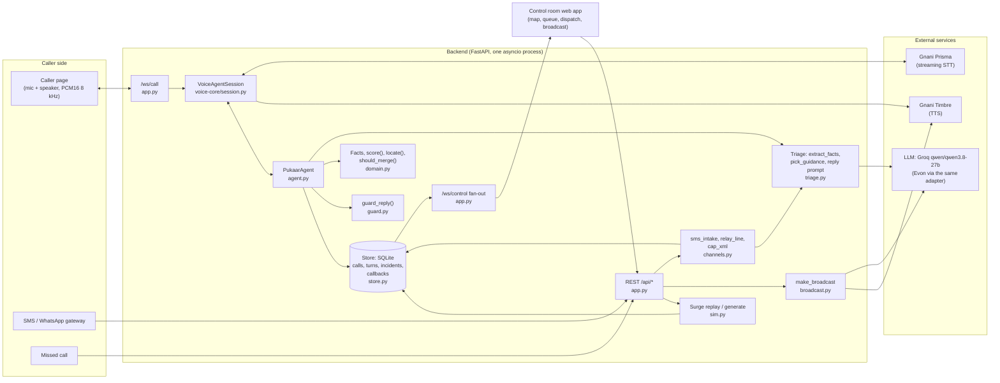

# Pukaar architecture

Pukaar is an overflow voice line for floods and other disasters. A caller speaks in their own language; Pukaar
answers calmly, asks one question at a time, extracts the facts, scores severity with reasons, puts the caller on a
map, merges duplicate reports, and lets a dispatcher act on them. This page describes how the code does that. Every
statement points at the module that implements it. For the wire formats see [API.md](API.md).

## Components

`voice-core/` is the shared voice engine (also used by the team's other products). It owns the realtime session,
the Gnani clients and the LLM adapter. `backend/pukaar/` is everything specific to disaster response.

## The caller pipeline

One call is one `VoiceAgentSession` (voice-core) driving one `PukaarAgent` (`agent.py`):

1. **Answer at once.** `session.start()` sends `session_started` and starts the greeting before speech-to-text has
   even connected. The greeting is Tamil plus a Hindi question (`agent.GREETING`), pre-rendered by Timbre and
   cached on disk at startup (`assets.load_or_make_fillers`), so the first words never wait on the network.
2. **Prisma hears the caller.** Caller audio (PCM16, 8 kHz, phone quality) streams to Gnani Prisma with a
   language hint `ta-IN,hi-IN,en-IN,te-IN` and key terms (`domain.KEYTERMS`: hazard words plus every gazetteer
   locality, so place names are recognised in noise). The first transcript's language switches the reply language
   (`PukaarAgent.on_language`) if Timbre speaks it.
3. **Triage extraction.** For each caller turn, `triage.extract_facts` asks the LLM for one JSON object of
   facts (JSON mode, temperature 0) given the known facts and the last 6 turns. `Facts` (`domain.py`) validates it
   leniently: unknown enum values are dropped, a malformed field (`"trapped": "unknown"`) is removed without losing
   the other facts, and coordinates from the LLM are discarded (positions come only from GPS or the gazetteer).
   Any exception returns the previous facts, so extraction can never break a call. The reply and the incident
   update share one extraction per turn (`PukaarAgent._facts_for`), shielded so a barge-in that cancels the reply
   does not cancel it.
4. **Explainable severity.** `domain.score` is a fixed points table, not a model: hazard, water level, trapped,
   on roof, vulnerable people (capped at 25), medical needs (capped at 25), the worst injury, and head count.
   It returns the score (0 to 100), the level (critical 70+, high 45+, medium 25+, low) and the list of drivers
   with their points, which the control room shows next to every incident.
5. **Location.** `domain.resolve_locality` maps the LLM's spelling, or else the caller's own words, to the Chennai
   gazetteer (`backend/data/gazetteer_chennai.json`, with Tamil-script aliases) by fuzzy matching, and rejects a
   match more than 3 km from the caller's GPS. `domain.locate` returns `(lat, lon, source, confidence)`: GPS wins
   for coordinates; a landmark alone gives the gazetteer centre with lower confidence.
6. **The reply, guarded.** `triage.next_slot` picks the one missing fact to ask about (location, people,
   injuries, water level, vulnerable), skipping slots already asked. `triage.pick_guidance` offers at most two
   approved instructions from `backend/data/guidance_kb.json` for this hazard and situation. The LLM writes a
   2 to 3 sentence reply in the caller's language and must tag any instruction with its id, like `[[FLD-03]]`.
   The reply is not streamed: `guard.guard_reply` must see all of it first (next section).
7. **Timbre speaks it.** The session splits the guarded text into sentences and streams Timbre audio back.
   Short filler clips ("சரி, கேக்கறேன்.") cover the thinking time; a barge-in stops playback (`stop_audio`).
8. **Every turn updates the incident** (`PukaarAgent.on_user_turn` → `Store.upsert_incident`) and the session
   sends an `incident` event, which the app forwards to the control room.

## Safety guarantees and how they are tested

The caller hears only what the guard allows. If any rule fails, the whole reply is replaced by a fixed, safe
line in the caller's language (`guard.fallback`): "Help is being arranged. Please stay on a high, dry place."

| Guarantee | Code | Tests |
|---|---|---|
| Only approved guidance: every `[[ID]]` must be one of the offered candidates, and a malformed tag fails the reply | `guard.guard_reply` | `test_triage.py::test_guard_reply`, `test_guard_keeps_every_approved_line_and_plain_questions`, `test_agent.py::test_tag_without_words_is_not_logged_as_given` |
| No arrival-time or "coming soon" promise unless a dispatcher entered an ETA, in English, romanised Hindi, Devanagari, Tamil, Telugu, Kannada, Bengali and Malayalam | `guard._TIME_RE` | `test_guard_blocks_time_promises_in_words_hours_and_telugu`, `test_guard_blocks_soon_promises_in_every_language` |
| No false reassurance ("you are safe") | `guard._SAFE_RE` | `test_guard_blocks_false_reassurance` |
| No flood advice ("stay high") for fire, landslide or building collapse | `guard.fallback`, `NOT_HIGH_GROUND` | `test_fallback_gives_high_ground_advice_only_for_water_hazards`, `test_agent.py::test_fire_caller_fallback_has_no_flood_advice` |
| Never "the control room can see you on the map" before the caller is located | `agent.reply_sentences`, `channels.sms_intake` (GEN-01 withheld) | `test_unlocated_caller_is_not_told_they_are_on_the_map`, `test_unlocated_sms_is_not_told_the_control_room_sees_them` |
| Translations of dispatcher text add no time, number or reassurance | `guard.adds_nothing`, used by `agent.dispatch_line` and `channels.relay_line` | `test_relay_never_adds_a_time_promise_reassurance_or_number`, `test_dispatch_translation_never_changes_the_eta_or_drops_the_team` |
| The LLM never invents facts or positions | `Facts._drop_invalid`, `extract_facts` drops lat/lon, prompt forbids defaults | `test_extract_facts_parses_and_drops_invalid`, `test_one_malformed_field_keeps_the_other_new_facts`, `test_extract_prompt_forbids_default_facts` |
| A second caller never lowers an incident's severity | `domain.merge_reports` | `test_a_merged_second_caller_never_lowers_the_incident` |
| CAP alerts are drafts, and always well-formed XML | `channels.cap_xml` (`status="Exercise"`, `_xml_text`) | `test_cap_xml_has_one_info_block_per_language`, `test_cap_xml_stays_well_formed_with_control_characters_and_markup` |

The whole suite runs keylessly on fakes (`voice_core.testing.FakeLLM`, fake STT/TTS) in GitHub Actions
(`.github/workflows/ci.yml`).

## Incident store and dedup

`store.Store` is SQLite (`cache/pukaar.db`; `pukaar_fake.db` in fake mode) with four tables: `calls`, `turns`,
`incidents` (the `Incident` model as JSON, plus status and time columns) and `callbacks`. The connection is
shared by the one asyncio thread (`check_same_thread=False`), and every write commits at once.

`Store.upsert_incident(call_id, facts, loc)` runs after every caller turn:

- A call's first report creates an incident, unless `domain.should_merge` finds a matching open one.
- Two reports merge only if the **hazard is known and equal**, the incident is not resolved and was updated in
  the last 3 hours (`MERGE_WINDOW_S`), and either both have real positions (GPS, not a shared gazetteer centre)
  less than 300 m apart, or both name the same locality and a similar landmark (similarity 0.7 or more). An
  unknown hazard joins nothing yet; it is re-checked on every turn, so a call can merge once its hazard is heard.
- If a call that owns a single-caller pin later turns out to duplicate another incident, its pin is deleted and
  its guidance history moves to the target.
- Merged facts use `domain.merge_reports`: lists union, head count max, water level the highest, `trapped` and
  `on_roof` true if anyone said so. Severity is recomputed from the merged facts.
- `list_incidents` sorts by severity score, then age, which is the dispatch queue order.

## Control-room fan-out

`/ws/control` sends a snapshot (incidents, KPIs, live call ids) and then joins a set of sockets. The app's
`broadcast()` sends each event to every socket and drops any socket whose send fails, so one dead screen cannot
stall the others. Caller sessions forward their `turn`, `language` and `incident` events (tagged with the call id);
REST actions (dispatch, resolve, SMS, missed call) and the surge push `incident` and `kpis`.

## Dispatch, callbacks and relay

- `POST /api/incidents/{id}/dispatch` stores `{team, note, eta}` and calls `agent.deliver_dispatch`. Each caller
  of the incident gets `dispatch_line`: a fixed English sentence built from the team and the ETA, translated by
  the LLM, guarded, and checked with `adds_nothing`; if the translation is blocked or adds anything, the English
  is sent instead. A live caller hears it at once (it interrupts the current speech); a caller who hung up gets a
  queued callback (`Store.queue_callback`), playable as audio from `/api/calls/{id}/callbacks/{cb}/audio`.
- After a dispatch with an ETA, live agents may mention that ETA (`PukaarAgent.eta`); the guard allows time
  words only then.
- `POST /api/incidents/{id}/message` relays the dispatcher's own English to every caller in their language with
  the same translation-only check (`channels.relay_line`).
- Missed call: `POST /api/missed-call` creates a call and a pin at once; the call back opens `/ws/call` with
  `callback_for`, which continues the same call id and incident with a callback greeting.

## Broadcast alerts and CAP

`broadcast.make_broadcast` translates one English alert into up to 7 languages in **one** LLM call (JSON mode).
Known place names are first replaced by tokens (`{P1}`), so the LLM cannot mistranslate them, and restored in each
target script from the gazetteer aliases. A translation that lost or mangled a token is dropped rather than
broadcast without its place. Each text is spoken by Timbre (MP3) and cached by a hash of text and voice settings.
`channels.cap_xml` exports the same alert as CAP 1.2 (the format India's SACHET alert system consumes) with one
`<info>` per language, `status` "Exercise", and XML-illegal characters removed.

## SMS intake

`channels.sms_intake` runs one text through the same extraction, location, dedup, guidance and guard as a call,
and returns a reply SMS. The language comes from the script; Latin-script texts are checked for common romanised
Hindi or Tamil words before trusting the LLM's guess. The same text (4 words or more) within 3 hours returns the
same incident and reply with no new LLM call, so a gateway retry costs nothing; two people texting just "help"
stay two pins.

## Noise drill

`drill.py` (run by `scripts/run_drill.py`) measures what rain noise and speech-to-text lose. Synthetic cases
(`sim.make_case`) are written as caller speech by the LLM, spoken by Timbre, band-limited to telephone quality,
mixed with synthetic rain (`assets.rain_noise`) at several SNRs, transcribed by Prisma and triaged. The reference
is the facts extracted from the exact words, so the score isolates the loss from noise and STT. Results are
committed to `backend/data/drill_results.json` and served by `GET /api/drill`. The live call can inject the same
rain (`noise_snr_db`).

## Concurrency

- **One asyncio event loop.** FastAPI, every WebSocket and every session run in one process. Calls are
  independent tasks; per-socket sends are serialised with a lock, and a failed send marks the socket dead instead
  of raising into the session.
- **The Gnani gate** (`voice_core/gnani/gate.py`). A key allows one short Gnani request at a time (a second
  concurrent REST call gets 429), so all TTS and REST STT requests share one app-wide semaphore
  (`GNANI_MAX_CONCURRENT`, default 1) and retry 429/5xx with 0.5, 1 and 2 s backoff. The long-lived Prisma
  stream is not gated. A waiter goes ahead after 20 s so a stuck holder cannot freeze the app.
- **The LLM token budget.** The Groq free tier allows about 8k tokens per minute, so: extraction sends only the
  last 6 turns plus the known facts; reply and incident update share one extraction per turn; session analysis
  is coalesced (a chatty caller marks it dirty instead of queueing calls); broadcasts translate every language in
  one call; the surge replays a recorded run with no LLM calls unless `fresh` is asked for; a repeated SMS costs
  nothing.
- **Startup.** Greeting and filler clips render in a background task at startup; `/api/health` reports
  `fillers_ready`.

## Failure handling

| Failure | What the caller or dispatcher sees |
|---|---|
| LLM error, timeout or empty reply | The guard's safe fallback line; extraction keeps the previous facts. |
| A reply that produced no audio | A pre-rendered clip, so there is never dead air (`"fallback": true` on the turn). |
| Prisma disconnects (train tunnel, 429) | The call stays up; `status: reconnecting`, reconnect with backoff, then `connected` or `error`. |
| Timbre rate-limited | The gate retries with backoff; fillers and the greeting come from the disk cache. |
| Translation blocked by the guard | The dispatcher's own English words are sent. |
| A control-room socket dies | It is dropped from the fan-out; other screens are unaffected. |
| No keys at all | `PUKAAR_FAKE=1` runs the whole app with a scripted Tanglish caller, a fake LLM and tone audio. |

## Privacy

- Every demo caller and every surge or drill case is synthetic (`sim.utterance_prompt` forbids real names and
  numbers).
- Data stays local: SQLite and the audio cache live in `cache/`, which git ignores. There is no sender phone
  number in SMS intake.
- Keys are read from `.env` or the environment (`voice_core.config`), never logged; `/api/health` reports only
  whether they are set.
- What leaves the machine: caller audio to Gnani Prisma, reply text to Gnani Timbre, and transcripts (last 6
  turns plus known facts) to the configured LLM provider.
